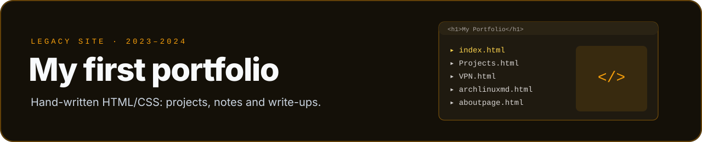
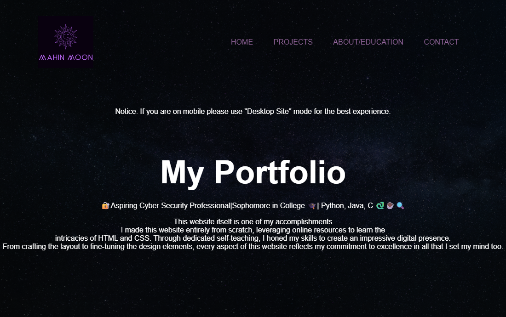

  

My first personal website, written by hand in **HTML and CSS** while I taught myself web basics. It's still live at
**[xirro9.github.io/Mahin-Moon](https://xirro9.github.io/Mahin-Moon/)**, but it's been replaced by my current
**[Portfolio](https://github.com/Xirro9/Portfolio)**.

  
   <b>Real screenshot</b> of the live home page

## Pages

| Page | Contents |
|---|---|
| `index.html` | home |
| `Projects.html` | OGE App, this website, Python mini-projects, a WireGuard VPN, a custom Arch Linux install |
| `VPN.html` | setting up a VPN with WireGuard |
| `archlinuxmd.html` · `archvideo.html` | notes on building a custom Arch Linux setup |
| `aboutpage.html` · `contact.html` | about, education and contact |
| `OGEAPP.html` | the OGE App project |

The repo also holds the small Python scripts the site shows off: a Caesar cipher (`ceaserencrypt.py`,
`anticeaser.py`), a GPA calculator (`GPAcalc.py`) and rock-paper-scissors (`RockPaperScissors.py`).

Kept as-is for history. The site notes that it's best viewed in desktop mode on phones.
